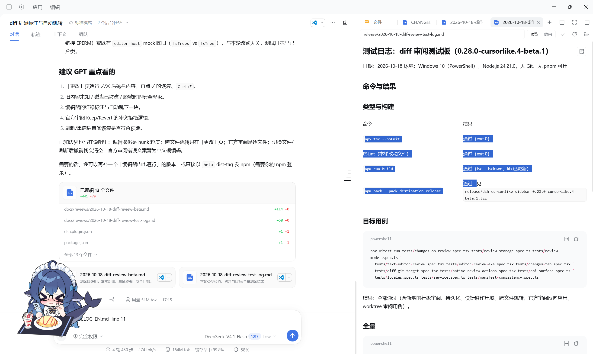
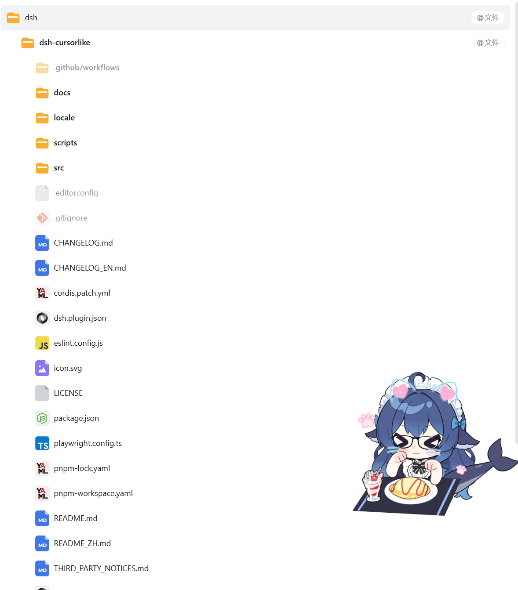
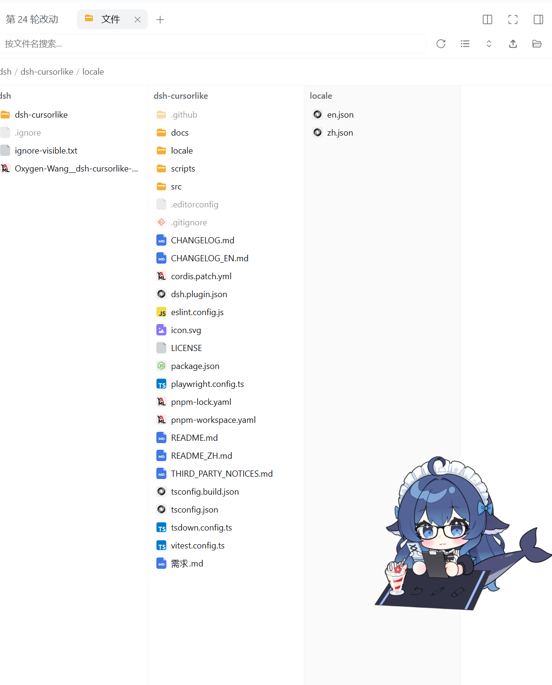
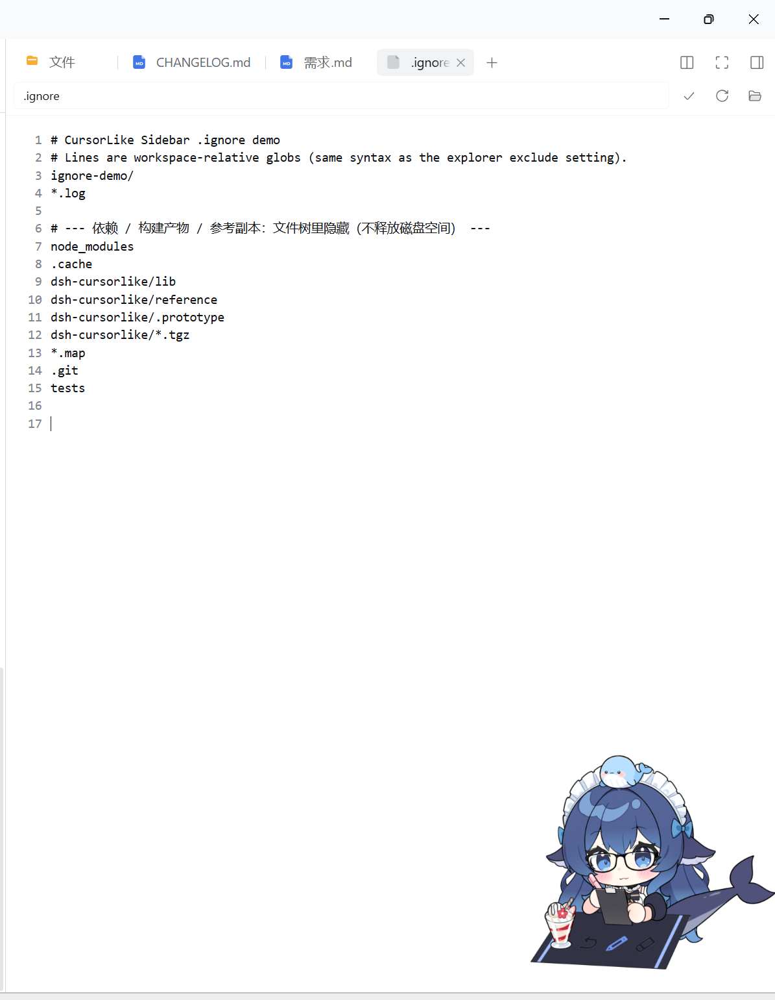
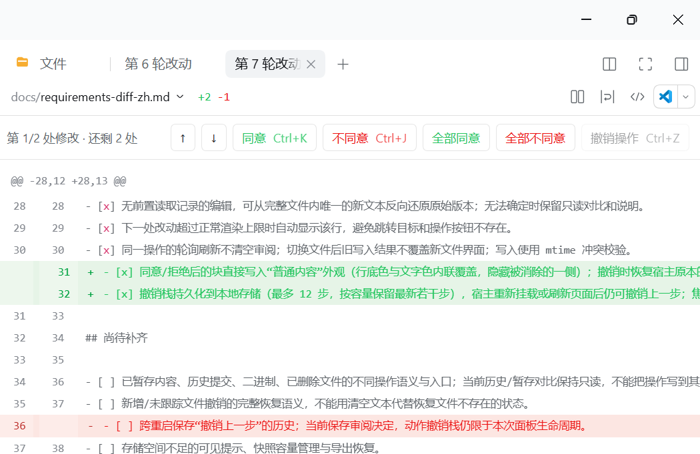
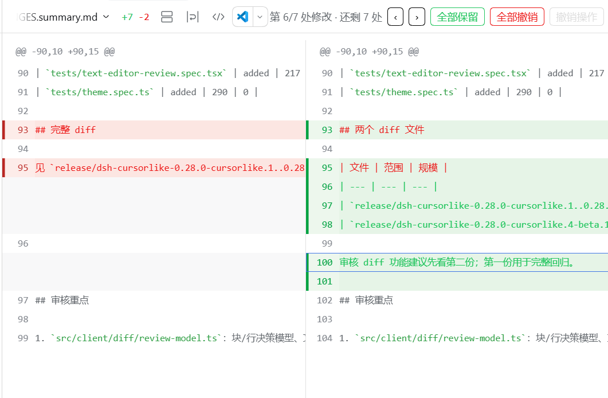

# CursorLike Sidebar

**让 DSH 对话与项目文件在同一工作区协作。**

**Browse files, bring code into chat, and review agent edits inside DeepSeek Harness.**

`dsh-cursorlike-sidebar` 是嵌入 DSH 原生右侧栏的工作区插件，提供文件浏览、代码编辑、Markdown 预览、Git 差异、原生终端、侧边对话与分屏，主题随 DSH 切换。

A workspace sidebar for DSH with a file browser, code editor, Markdown preview, Git diffs, native terminal, side chat, and split panes. It follows the DSH theme.

独立 DeepSeek Harness 插件，与 Cursor / Anysphere 无隶属关系。

An independent DeepSeek Harness plugin, unaffiliated with Cursor or Anysphere.

[功能介绍 · Features](#features) · [安装 · Installation](#installation) · [快捷键 · Shortcuts](#shortcuts) · [更新日志](./CHANGELOG.md) · [Changelog](./CHANGELOG_EN.md)



*实际使用截图：左侧对话、右侧 Markdown 预览，选中文字后添加带行号的引用。 / In-app screenshot: chat beside a Markdown preview, with selected text referenced by line number.*

<a id="features"></a>

## 功能介绍 · Features

### 1. 按习惯浏览文件 · Browse your way

同一个工作区支持三种视图，可从文件面板工具栏切换：

- **桌面图标网格 / Icon grid**：默认视图，三列排列，首格返回上级。单击文件夹进入、单击文件打开，适合直观浏览。
- **树形列表 / File tree**：展开目录层级，查看项目结构，适合定位源码。
- **Miller 多列 / Miller columns**：逐级目录并排展开，适合在深层路径间浏览。

Switch between a default icon grid, a hierarchical file tree, and Miller columns without leaving the workspace.

**桌面图标网格 / Icon grid**


**树形列表 / File tree**



**Miller 多列 / Miller columns**




右键可打开文件、新建 Tab、侧边打开、添加引用或复制路径。支持文件多选、复制/剪切/粘贴、重命名、删除及文件操作历史。网格中按住 `Ctrl` 滚轮可调整图标大小（24–160px），64px 以上的图片图标显示缩略图；树形视图支持 10–32px 图标缩放。

Use context menus and multi-selection to manage files, with clipboard operations and file operation history. Ctrl + mouse wheel adjusts icon size, with image thumbnails in larger grid sizes.

### 2. 把文件和选区带入对话 · Bring context into chat

选中文件或代码后按 **`Ctrl+L`**，即可把相关上下文添加到当前对话，减少复制路径、粘贴代码的步骤。

- 文件浏览器：选中文件后添加文件引用。
- 代码编辑器：选中代码后添加行范围；没有选区时添加当前行。
- Markdown 预览：选中文字后映射到源码行号，支持正文中的粗体、列表、行内代码。
- 拖放：将文件引用或选中代码拖入聊天输入区，也可把文件引用拖到文件面板打开。

Press **Ctrl+L** on a selected file, code selection, or Markdown preview text. References use a native `@file` chip with a line suffix such as `line 12-18`. With no editor selection, the current line is referenced. Drag files or selected code into chat for the same workflow.

引用格式示例：`@src/app.ts line 12-18`。Markdown 预览无法唯一定位源码时，会退化为文件引用并附上选中文字，保留必要上下文。

If a Markdown selection cannot be mapped uniquely to source lines, the reference includes the selected text as a fallback.

### 3. 隐藏无关文件 · Keep the file browser focused

在**工作区根目录**创建 `.ignore`，隐藏依赖、构建产物或日志。也可把文件或文件夹拖到工具栏的 **`.ignore` 眼睛图标**，自动追加规则并刷新。

Create a root-level `.ignore` to hide distracting files, or drag a file or folder onto the ignore icon to append a rule and refresh the browser.

```gitignore
node_modules
.cache
*.log
```



规则使用 gitignore 风格的 glob，当前仅读取根目录 `.ignore`，不支持 `!` 反向选择。手动编辑后点击刷新。隐藏仅影响文件展示，不会删除文件，也不会释放磁盘空间。

Rules use gitignore-style globs. Only the workspace root file is read, and `!` negation is unsupported. Refresh after manual edits. Hiding files affects display only and does not delete them.

### 4. 逐块审查 Agent 修改 · Review agent edits by hunk



*实际使用截图：原生「第 N 轮改动」页按块审阅。工具栏显示「第 N/M 处修改 · 还剩 K 处」，提供 ↑ / ↓ 跳转、同意 / 不同意、全部同意 / 全部不同意和撤销操作（做出决定后可用）。 / In-app screenshot: block review on the native turn page — position, previous/next, accept/reject, bulk actions, and undo (enabled after a decision).*

原生「第 N 轮改动」页**默认单栏对比**，可手动切换左右分栏。连续改动行合并为一个更改块，每块只显示一组**同意 / 不同意**，也可**全部同意 / 全部不同意**。使用 **↑ / ↓** 跳到上一处或下一处，支持 Tab 聚焦按钮和恢复已保存的审阅决定。**Ctrl+K 同意、Ctrl+J 不同意、Ctrl+Z 撤销上一步**，快捷键直接显示在独立审阅工具栏中。待处理内容以红绿对比显示；同意后恢复普通背景、保留新内容并隐藏旧行，Ctrl+Z 后重新显示原始对比。撤销栈保存在本地，宿主重新挂载或刷新页面后仍可撤销上一步。窄面板中操作按钮移到块下方，避免挤压文字。

The native turn review opens in unified view, with split view available on demand. Consecutive changed lines form one block. Accepting a block shows ordinary file content and hides the removed side; Ctrl+Z restores its original comparison. The toolbar shows the current position, previous/next navigation, individual and bulk decisions, and undo; Ctrl+K accepts, Ctrl+J rejects, and Ctrl+Z undoes the last decision. Undo history survives host remounts and page refreshes. Narrow panes place block actions below the text.

手动切换左右分栏后，同一组块操作仍然可用：



*左右分栏对比（手动切换）。 / Side-by-side comparison (manual switch).*

Agent 修改当前打开的文件后，编辑器直接显示内联差异：新增或改写行标绿，旧内容以红色删除块显示。按改动块（hunk）逐个**保留 / Keep** 或**撤销 / Revert**，处理后自动跳到下一处，操作条显示进度，也可一次处理全部修改。

The editor highlights agent edits inline, with green additions and red deleted content. Keep or revert individual hunks, move automatically to the next change, or handle all changes at once.

「更改」页按连续更改块审查本轮 write/edit 操作：每块提供保留 / 撤销，处理后跳到下一处，一个文件处理完后切到下一个改动文件。只有能重建完整旧内容、且磁盘仍匹配该操作结果时才启用写回；否则显示只读 diff 与原因。**拒绝改动会立即写回磁盘。**

The Changes tab groups consecutive changed lines into one review block. Keep or reject a block, move to the next change, and advance to the next file when finished. Ctrl+K accepts, Ctrl+J rejects, and Ctrl+Z undoes the last decision. Review requires a complete previous version and a matching current file; otherwise it stays read-only with an explanation. **Rejecting a change writes to disk immediately.**

未处理的编辑器审查状态按会话与文件保存在本地。重启后，文件仍匹配待审版本时恢复；处理完毕后清除。

Pending editor reviews are saved locally per session and file, and restored after restart when the file still matches the pending version.

### 5. 编辑、终端与分屏 · Edit, run, and compare

代码编辑、Markdown 预览、搜索、Git 差异、原生终端与侧边对话都可在 DSH 中使用。分屏便于并排查看文件和操作结果，减少在外部窗口间切换。

Use editing, previews, search, Git diffs, a native terminal, and side chat inside DSH. Split panes help keep files and results visible together.

安装 `dsh-diff-approval` 时，本插件还提供原生右侧栏 dock 集成与 Keep/Revert 快捷键转发。首次将其旧浮层迁到 dock 后，会保留用户显式改回 float 的选择。

Optional `dsh-diff-approval` integration docks its review panel in the native sidebar and forwards Keep/Revert shortcuts, while respecting a later explicit switch back to floating mode.

<a id="shortcuts"></a>

## 常用快捷键 · Shortcuts

快捷键随焦点生效：文件操作、文本编辑和 Diff 审查各自使用对应上下文。

Shortcuts act on the focused browser, editor, or review surface.

- **`Ctrl+L`**：文件、选区或当前行添加到会话 / Add file, selection, or current line to chat.
- **`Ctrl+C` / `Ctrl+X` / `Ctrl+V`**：文件浏览器中复制、剪切、粘贴 / Copy, cut, and paste files in the browser.
- **`Ctrl+Z`**：撤销当前上下文中的操作；审查时撤销上一步决定 / Undo in the active context, including the last review decision.
- **`Ctrl+Shift+Z` / `Ctrl+Y`**：文件浏览器中重做 / Redo file browser operations.
- **`F5`**：刷新文件浏览器 / Refresh the file browser.
- **`Ctrl+K` / `Ctrl+J`**：同意 / 不同意当前改动块（编辑器、「更改」页、官方轮次审阅）/ Accept or reject the active block (editor, Changes tab, turn review).
- **`Ctrl+Alt+K` / `Ctrl+Alt+J`**：全部同意 / 全部不同意当前审阅 / Accept or reject every remaining block in the active review.
- **`Ctrl+滚轮 / mouse wheel`**：调整文件图标大小 / Resize file icons.

保留 DSH 原有 `Ctrl+B` 行为，无需额外桌面软件或 Python 运行时，不包含 PDF 依赖。

The plugin preserves DSH's existing Ctrl+B behavior and requires no additional desktop app or Python runtime. It does not bundle PDF dependencies.

<a id="installation"></a>

## 安装 · Installation

适配 DSH 0.2.1-rc.1 及兼容版本。安装前停用原版 `dsh-better-sidebar`，安装或更新后完全退出并重启 DSH。

Requires DSH 0.2.1-rc.1 or a compatible version. Disable the original `dsh-better-sidebar` before installing, then fully restart DSH after installation or updates.

### npm（发布后可用 · After publication）

插件发布到 npm 后可安装包名：

```powershell
dsh plugin --profile desktop add dsh-cursorlike-sidebar
```

只有 npm / GitHub 来源能被 DSH Plugin Market 检查更新；本地 `link:` 安装和固定 tag 的 tarball 不会自动更新。

### Release（不需要 Git · No Git required）

以下为固定的历史版本 `0.28.0-cursorlike.1`，不代表当前工作区版本。其他版本请在 [Releases](https://github.com/Oxygen-Wang/dsh-cursorlike-sidebar/releases) 选择对应资源。

The command below installs the pinned historical release, not the current workspace version.

```powershell
dsh plugin --profile desktop add https://github.com/Oxygen-Wang/dsh-cursorlike-sidebar/releases/download/v0.28.0-cursorlike.1/dsh-cursorlike-sidebar-0.28.0-cursorlike.1.tgz
```

### GitHub（需要 Git · Requires Git）

需要本机 `git` 在 PATH 上（pnpm 解析 `github:` 规格会调用 git）：

```powershell
dsh plugin --profile desktop add github:Oxygen-Wang/dsh-cursorlike-sidebar
```

也可以在 DSH 的「添加插件」里填入上面的 GitHub 规格，安装后重启 DSH。
仓库已提交构建好的 `lib/`（不含 source map），因此 GitHub 安装不需要本地构建。

### 本地开发 · Local development

插件已经以 `link:` 方式安装时，不需要每次重装。依赖只需装一次：

```powershell
npm install
```

启动监听（`tsdown --watch`，不需要 pnpm 在 PATH 上）：

```powershell
npm run dev
# 或： pwsh -File scripts/dev.ps1
```

- 改客户端代码：保存后按 `Ctrl+R` 刷新 DSH 页面；
- 改 Host 代码（`src/index.ts`、`src/*.ts`）：需要完全重启 DSH；
- 一次性构建：`npm run build`
- 类型检查：`npm run typecheck`

在 DSH「添加插件」里选择本地目录 `dsh-cursorlike`。
先停用原版 `dsh-better-sidebar`：本分支保留其内部服务和路由，二者不能同时启用。
安装或更新后需要重启 DSH，插件才会在原生右侧栏中挂载。
通过 DSH 原生右侧栏入口使用。

## 更新方式 · Updates

DSH 的 **Plugin Market** 会为已安装插件做更新检查：

- **npm 安装**：比较已安装版本与 npm `latest`，有一键 Update / Update all；
- **GitHub 安装**：比较 git HEAD 与版本；只有版本前进（发版/改版本号）才提供更新，普通 commit 只显示“有新提交（未发版）”；
- **本地 `link:`**：不会自动更新——它始终使用目录里的 `lib`，改完执行 `npm run build` 后刷新页面即可；
- **固定 tag 的 tarball**：不会自动更新，需要重新安装新 tarball。

所以给最终用户用时，推荐发布到 npm：

```powershell
npm login
npm publish --access public --tag latest
```

发布后在 DSH「设置 → Plugin Market → 已安装」里检查更新；市场只自动**检查**，应用更新需要点一次 Update（不会静默替换代码）。

## 开发与来源 · Development & credits

```powershell
pnpm typecheck
pnpm test:windows
pnpm pack
```

`reference/` 为研究源码，`.prototype/` 为早期原型，两者不进入安装包。
改动审查交互另参考 [dsh-diff-approval v0.35.0](https://github.com/9087/dsh-diff-approval)。当前分支已实现编辑器与「更改」页的逐块保留/撤销。

Based on [Better Sidebar v0.28.0](https://github.com/omdsh-dev/DSH-better-sidebar), with review interaction references from dsh-diff-approval. Distributed under the [MIT license](./LICENSE). See [third-party notices](./THIRD_PARTY_NOTICES.md).
构建和自动化测试不能替代真实 DSH 桌面端的安装、拖放验证。
